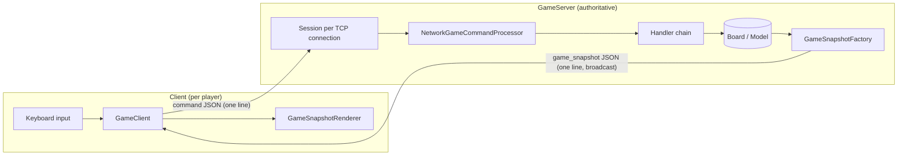

# Terminal Maze Game

A multiplayer roguelike dungeon crawler that runs entirely in the terminal. Written in **C# / .NET 9** as a university project on object-oriented design, then extended with an **authoritative TCP server** so up to 9 players can explore the same dungeon at once.

<!-- Add a short recording here, e.g.  -->

## Highlights

- **Client–server multiplayer** – one authoritative server owns the game world; thin clients send key presses and render JSON snapshots.
- **Procedural dungeons** – rooms, corridors and a central hall generated by a builder, with optional themed worlds (Sea, Hospital).
- **Enemy AI** – enemies path-find to players with **BFS** and react to noise: picking up an item emits a sound wave that propagates through the map (also BFS) and is blocked by walls.
- **Turn-based combat** – three attack types (normal, sneaky, magic) resolved against the weapon in each hand.
- **Inventory system** – backpack, left/right hand slots, decorated weapons with modifiers.
- **~8.9k lines of C#** organised into Model / View / Controller / Communication / Server / Client layers.

## Architecture



**Protocol.** Newline-delimited JSON over TCP. A client sends `{"type":"command","key":"W"}`; after every command the server broadcasts a personalised `game_snapshot` to every connected player (board, player stats, inventory, nearby enemy, fight state, log lines, visual effects).

**Concurrency.** Each client is handled by its own async task. Commands from all players are serialised through a `SemaphoreSlim`, so the shared world is mutated by one command at a time, and each session has its own write lock so broadcasts never interleave on a socket. Players join and leave at runtime; the server rejects connections beyond 9 players.

**Local mode.** The same model and controller also run in a single-process mode that renders directly to the console, without any networking.

## Design patterns

| Pattern | Where | Used for |
|---|---|---|
| Chain of Responsibility | `Controller/Handlers/` | Each key press passes through fight → seek → escape → move → pick-up → log → backpack handlers |
| Builder | `Model/Builder/` | Step-by-step dungeon generation (`DungeonBuilder`) |
| Abstract Factory | `Model/Themes/` | Themed pools of enemies, items and weapons |
| Strategy | `Model/Enemies/MovementStrategies/`, `Death Reaction Strategies/` | How enemies react to players, sounds and the death of their kin |
| Observer | `Model/Enemies/Species/`, `PickUpSoundBus` | Species groups notify members; sound events reach enemies in range |
| Visitor | `Model/Fight/Classes/Visitors/` | Attack types resolved per weapon class |
| Decorator | `Model/Tools/Classes/Decorators/` | Weapon modifiers (strong, unlucky) |
| Singleton | `Configurator`, `Logger`, `GameView` | Shared configuration, logging and view |
| DTO / Snapshot | `Communication/Snapshots/` | Serializable game state sent over the network |

## Running

Requires the [.NET 9 SDK](https://dotnet.microsoft.com/download).

```bash
git clone https://github.com/ksobczynski/Terminal-Maze-Game.git
cd Terminal-Maze-Game

# single player, no networking
dotnet run -- --local

# multiplayer: start a server…
dotnet run -- --server 5555

# …and connect any number of clients (up to 9)
dotnet run -- --client 127.0.0.1:5555
```

Running without arguments asks interactively which mode to start. Use a terminal with Unicode support; the board uses box-drawing and symbol characters.

## Controls

| Key | Action |
|---|---|
| `W` `A` `S` `D` | Move |
| `E` | Pick up the selected object |
| `←` `→` | Cycle through objects on the current tile |
| `B` | Toggle backpack mode |
| `↑` `↓` | Move through the backpack (in backpack mode) |
| `L` / `R` | Swap the selected backpack item with the left / right hand |
| `Q` | Drop the selected backpack item |
| `J` | Toggle the log view (scroll with `↑` `↓`) |
| `Enter` | Fight the nearest enemy |
| `1` `2` `3` | Choose attack: normal, sneaky, magic (during a fight) |
| `L` / `R` | Choose which hand attacks (during a fight) |
| `Esc` | Leave a fight / quit (local mode) |

## Configuration

`appsettings.json`:

```json
{
  "GameSettings":  { "PlayerName": "Player" },
  "LogSettings":   { "OutPath": "./Model/Logging/Logs/gameplay-{date}" },
  "ThemeSettings": { "Theme": "Default" }
}
```

`Theme` accepts `Default` (randomly generated rooms and corridors), `Sea` or `Hospital`. Gameplay events are written to a timestamped log file.

## Project structure

```
├── Client/          TCP client and snapshot renderer
├── Server/          Authoritative game server and per-player command processing
├── Communication/   Network messages, snapshots and action results
├── Controller/      Input handler chain and fight menu
├── Model/           Board, player, enemies, items, combat, dungeon builder, themes
├── View/            Console rendering (board and UI boxes)
├── Program.cs       Entry point and launch-mode parsing
└── appsettings.json
```
